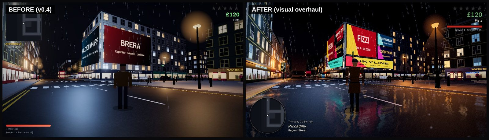
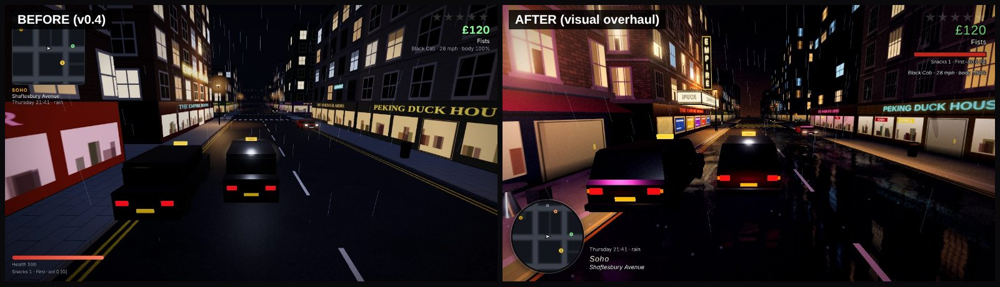
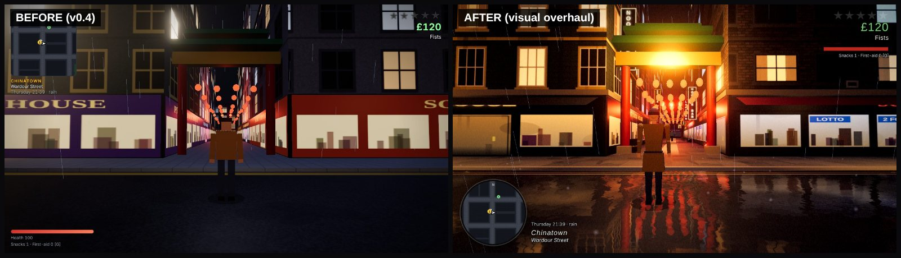
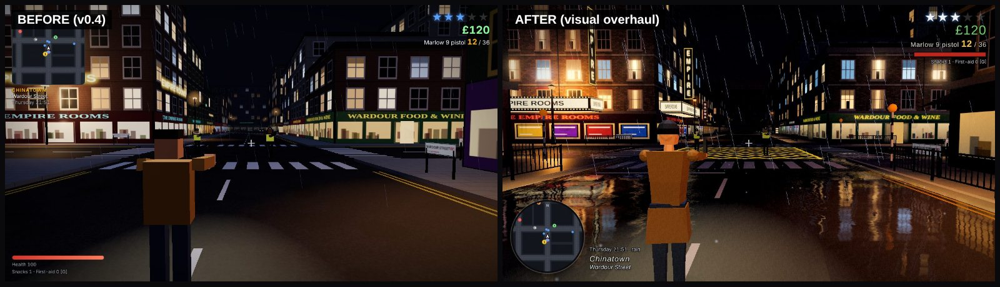
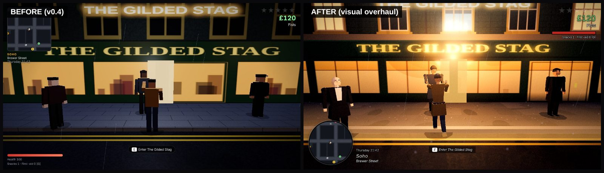
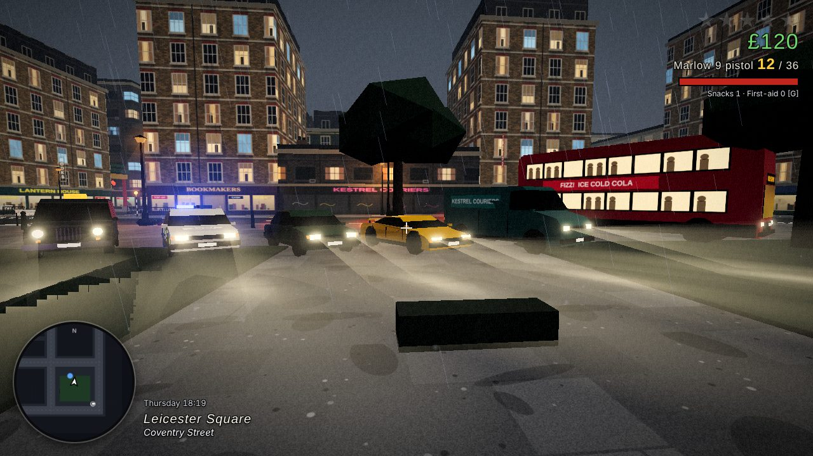
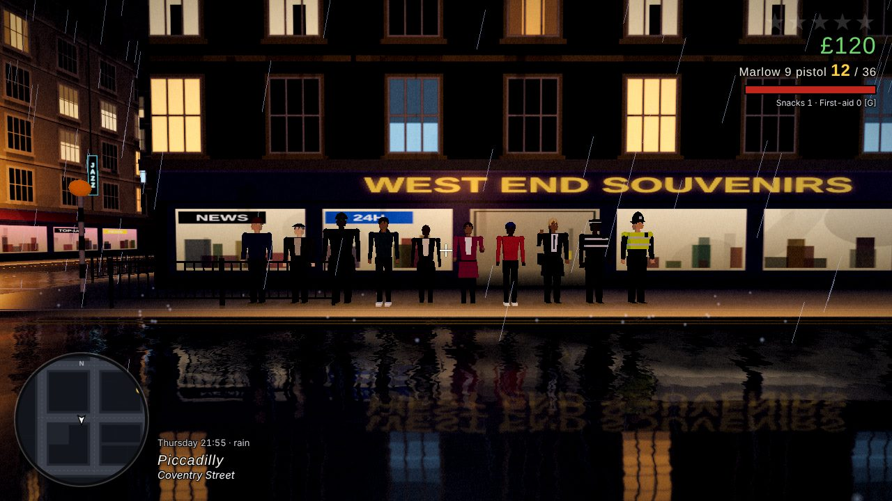
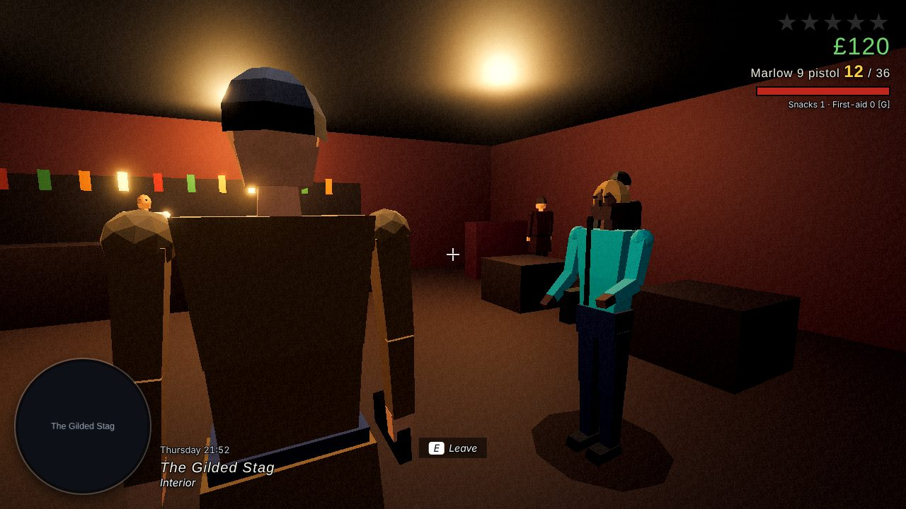

# CAPITAL: AFTER DARK

An original third-person, open-world action game set in a rainy, night-time slice of London's West End -
Soho, Piccadilly Circus, Chinatown and Leicester Square. You are a minicab driver on the night shift; one odd
fare drags you between two rival crews and a property developer who is quietly burning the neighbourhood down.

This is a **playable prototype (version 0.5)**, not a concept. Everything listed under
[What is implemented](#what-is-implemented) runs in the browser today and is exercised by the automated
browser checks in [`tests/e2e`](tests/e2e/gameplay.mjs). Everything that is *not* done is listed under
[Known limitations](#known-limitations) and the [Roadmap](#roadmap).

- Engine: TypeScript · Three.js (rendering) · Rapier 3D (physics) · Vite (build)
- No backend, no cloud AI, no paid services, no third-party art or audio - see [ATTRIBUTION.md](ATTRIBUTION.md)
- Original game: no code, assets, characters or branding from any commercial title

## Install and launch

Requires Node.js 20+ and a desktop browser with WebGL 2 (Chrome, Edge or Firefox).

```bash
cd capital-after-dark
npm install
npm run dev          # development server → open http://localhost:5173
```

Production build:

```bash
npm run build        # type-checks, then bundles to dist/
npm run preview      # serves dist/ at http://localhost:4173
```

`dist/` is fully static (relative paths), so it can be hosted from any static web server or sub-folder.

**No Node? A pre-built copy is committed in [`play/`](play/).** Serve that folder with any static server
(`npx serve play`, `python3 -m http.server -d play`) and open it - browsers will not load the game straight
from `file://`. If GitHub Pages is enabled for this repository it is playable at
`<pages-url>/capital-after-dark/play/` once merged. Rebuild it with `npm run build:play`.

## Checks

```bash
npm test             # unit tests (Vitest): layout, graphs, wanted logic, saves, economy, progression
npm run build && npm run test:e2e    # real-browser gameplay checks (Playwright + headless Chromium)
npm run check        # everything above in one go
```

`test:e2e` needs Playwright with a Chromium build available to Node (`npm i -D playwright && npx playwright
install chromium` on a normal machine). It writes screenshots and `results.json` to `tests/e2e/out/`.

## Controls

| On foot | |
| --- | --- |
| `W A S D` | Move (relative to the camera) |
| Mouse | Look / aim (click the game to capture the mouse) |
| `Shift` | Sprint |
| `Space` | Jump |
| `C` | Crouch |
| Left click | Punch - keep clicking for a jab → cross → hook combo / fire |
| Right click | Block (fists) / aim down the shoulder (gun) |
| `V` | Kick (knocks people down) |
| `Q` | Dodge (brief invulnerability) |
| `1` `2` `3` / wheel | Switch weapon |
| `R` | Reload |
| `E` | Talk / interact / use doors |
| `F` | Get in or out of a vehicle (takes occupied cars too) |
| `G` | Eat a snack / use a first-aid kit |

| Driving | |
| --- | --- |
| `W` / `S` | Accelerate / brake, then reverse |
| `A` / `D` | Steer |
| `Space` | Handbrake |
| `H` | Horn |

| General | |
| --- | --- |
| `Esc` / `P` | Pause (save, settings, controls, standing with each crew) |
| `F5` | Quick save |

## What is implemented

### The district
- A connected 5 × 5 street network (20 named street segments, ~340 m across) with 16 city blocks:
  Regent Street, Great Windmill Street, Wardour Street, Dean Street, Charing Cross Road, Broadwick Street,
  Brewer Street / Old Compton Street, Shaftesbury Avenue, Coventry Street and Orange Street.
- Landmarks: the illuminated corner screens and stepped memorial fountain at Piccadilly Circus, the Chinatown
  gate and lantern-strung Gerrard Street, Leicester Square gardens, West End theatres, a tower-crane building
  site, pubs, late shops and neon.
- Raised pavements and kerbs, zebra crossings, double yellow lines, Westminster-style street nameplates,
  red phone boxes and pillar boxes, bollards, street lamps, alleyways and shortcuts.
- Night lighting with wet-road reflections, rain, bloom, a 24-hour clock (one game minute per real second)
  and changing weather. Synthesised rain, city rumble, engines, horns and a two-tone siren.

### Player
- Kinematic character controller: run, sprint, jump, crouch, dodge; climbs kerbs and steps; cannot pass
  through buildings, props or vehicles; cannot fall through the world.
- Third-person orbit camera with wall collision, an over-the-shoulder aim mode and a speed-sensitive chase camera.
- Health, damage, knock-downs, slow recovery, food and first-aid kits; hospital and arrest outcomes.

### Combat
- Melee: three-hit combo, kick, block (cuts damage 85 %), dodge with i-frames, knock-downs, KO. Opponents
  wind up visibly, block, and counter-attack.
- Firearms: Marlow 9 pistol and Kessler Compact SMG (automatic) - crosshair, hitscan with spread, magazines,
  reserve ammunition, reloading, weapon switching, head-shot bonus, tracers and muzzle flash.
- Bullets and fists change real state: NPC health, vehicle health, and walls and vehicles genuinely stop shots.
- Non-graphic presentation: impact puffs and knock-outs only.

### People
- Roles: pedestrians, office workers, tourists, nightlife crowd, cabbies, shopkeeper, publican, mechanic,
  beat officers, armed officers, two crews and hired heavies. Each has an activity, destination, mood,
  attitude and role-appropriate lines.
- Daily routine: the population mix and where people go depend on the hour (work in the morning, cafés at
  lunch, the pub or the station in the evening, nightlife after dark). People heading to the station leave the map.
- Reactions: witnesses flee, cower, stop and stare, fight back or phone the police; crews defend their own.
- Level of detail: characters beyond ~95 m are hidden and simulated at 3 Hz.

### The city that remembers (explicit, saved state)
- **Crimes need witnesses.** An unseen offence does nothing. A seen one is reported by an officer on the spot,
  or by a civilian who gets clear and makes a phone call (interrupt them and the call never happens).
- **Faction reputation** (−100…100 per crew): helping one costs you with the other. Below −30 a crew attacks
  on sight on its own ground; above +25 its members greet you.
- **District notoriety** (per district, fades over in-game hours): raises how warily locals treat you and
  what officers say to you.
- **Named characters with individual memory logs** - Tommo the busker, PC Bell, Farah (shop), Len (pub),
  Dezzie (garage), "Nails", Col Hartigan, Kes Reeve, Ines Duarte, Vivienne Marlowe. They store *what* they saw,
  *where* and *when*, quote it back to you, change prices, or bar you until you apologise and pay.
- **Saving**: cash, health, weapons, ammunition, items, owned vehicles, completed missions, story flags,
  reputation, notoriety, every character's memory, the clock and your position persist in `localStorage`
  (autosave after missions and every 90 s when safe, manual save in the pause menu, `F5`).

### Police
- Five wanted levels driven by *reported* heat (each incident counts once however many people saw it).
- Officers investigate unidentified disturbances, pursue on sight, radio your position, run to your **last
  known** position when they lose you, then search nearby street corners; the search clock resets if you are
  seen and the level clears if you stay hidden.
- Response scales with level: beat officers → area cars with crews who bail out → armed response.
- Arrest (stand still near officers, or get boxed in): fine, all ammunition confiscated, three hours lost,
  active mission failed, released at the station. Knocked out: treatment fee, four hours lost.

### Vehicles and traffic
- Black cab, saloon, sports car, delivery van, police car (all drivable) and double-decker bus (traffic only).
- Arcade handling on real rigid bodies: acceleration, steering, braking, reverse, handbrake slides, collision
  damage, engine smoke, wrecks.
- AI traffic keeps **left**, follows lanes around the network, queues, takes turns at junctions, brakes for
  people, and panics or stops with hazards on when rammed or shot at.
- Take parked cars or occupied ones (the driver is thrown out and reports you).

### Crews, businesses and interiors
- **The Marlowe Firm** (old Soho, run by Vivienne Marlowe from The Gilded Stag) and **The Kestrels**
  (couriers around Chinatown and Leicester Square, run by Tobias "Kes" Reeve).
- Three walk-in interiors with working services:
  - **Wardour Food & Wine** - snacks, meals, first-aid kits.
  - **Brewer Street Motors** - repair, buy vehicles, choose which owned vehicle is brought round.
  - **The Gilded Stag** - food and drink, gossip that reflects your record, and "Nails" for firearms and ammunition.
- Cash is earned (fares, deliveries, missions) and spent (shops, repairs, vehicles, weapons, fines, treatment).

### Story missions (all six playable start to finish)
1. **The Night Shift** - collect a fare at Piccadilly Circus and get her to Soho against the clock.
2. **Wrong Place** - return a lost phone, get jumped in an alley, learn to fight, pick up a pistol.
3. **The Delivery** - carry a fragile package across town; every crash damages it.
4. **Heat on the Streets** - steal a car in front of a constable, lose the police, deliver it clean.
5. **Choose a Side** - wreck the Kestrels' van *or* steal the Firm's cash car. Permanent reputation swing.
6. **After Dark** - meet a journalist, fight through hired security, take the ledger, escape a three-star
   response, and choose how it ends.

Each has objectives, fail conditions (wrecked vehicle, timer, arrest, hospital, walking away) and rewards.

### Emergent street events
Taxi fares (when you are driving the cab), parcel deliveries, pedestrian confrontations, crew disputes on
territory borders, traffic collisions, breakdowns you can drive to the garage, and police patrols whose tone
depends on your notoriety. Only one runs at a time, none start during missions or while wanted, and each
times out or is dismissed when you leave.

### Interface
Main menu (New Game / Continue / Settings / Controls), pause menu, HUD (health, cash, weapon and ammunition,
wanted stars, objective and timer, vehicle speed and condition, minimap with blips, clock, district and
street), interaction prompts, dialogue with choices, shop panels, mission banners, save indicator.
Settings: graphics quality (low / medium / high), volume, mouse sensitivity, invert Y, performance counter.

## Visual overhaul (v0.5)

A pure art-direction pass over the v0.4 mechanics prototype: no gameplay systems were added, and the same
25 browser gameplay checks pass on the new build. The target was a gritty, rainy, early-2000s console look.
Before / after pairs below are captured by the same script from the same positions
(`tests/e2e/screenshots.mjs`, sheets built by `tests/e2e/compare.mjs`).







New line-ups:  

**What changed**

- **Wet streets**: a real planar reflection of the scene over the tarmac, broken up by puddles and ripples,
  so neon, shopfronts, headlights and the LED wall smear down the road. Rain splashes, lit rain under lamps.
- **Lighting and grade**: darker ambient, sodium-orange street lamps, coloured light thrown by neon and
  screens, shop light spilling across the pavement, a sky dome with a dirty horizon glow, and a final grade
  (crushed blacks, cold shadows, warm highlights, vignette, film grain).
- **Buildings**: repainted brick, stone, stucco and faience facades with sills, arches, blinds, curtains,
  soot and drainpipes; cornices, slate mansards with dormers, chimney stacks; taller blocks.
- **Street identity**: projecting neon blade signs, awnings, shuttered shops with tags, window stickers,
  theatre canopies with bulb-lit marquees and vertical signs, a two-face wall of LED advertising panels at
  the Circus, a second Chinatown gate with strung lanterns and restaurant signs, cinema neon on the Square.
- **Street furniture and clutter**: bus shelters with lit adverts and BUS STOP road text, pedestrian guard
  railings, Belisha beacons, yellow box junctions, give-way lines, LOOK RIGHT / LOOK LEFT at crossings,
  manhole covers, granite kerbs, scaffolding with debris netting and barriers, bin bags, boxes, wheelie
  bins in the alleys, A-boards, street cabinets, café tables, newspaper stands, cones, fly-posted hoardings,
  re-modelled phone boxes, pillar boxes and lamp columns.
- **Characters**: rebuilt as tapered, jointed figures (elbows, knees, necks, hands, shoes) with coats,
  hoods, skirts, ties, bags, aprons, hi-vis vests and proper police headgear; new walk / run cycle with knee
  and elbow bend, guard stance, extending punches, two-handed aim, crouch, cower and phone poses.
- **Vehicles**: each type extruded from its own side profile with tumblehome, glazing, arches, bumpers,
  mirrors, door shuts, hubcaps and UK plates. The cab is tall and upright with round lamps and a chrome
  grille; the police car has chequered flanks, rear chevrons and a blue light bar with glow; the bus has
  two lit decks with passengers, blinds and a side advert; headlamp beams, brake-light bloom, and a real
  spotlight on the car you drive.
- **Camera and HUD**: a lower, off-centre follow camera with lag, sprint and speed field-of-view changes,
  a chase camera that leads into corners, a wider over-the-shoulder aim; a chunkier outlined HUD with a
  round radar.

**What still does not meet the target**

- **Street proportions are unchanged.** Every street is still the same ~20 m wall to wall on a regular grid,
  so Soho's narrow lanes and the real shapes of Piccadilly Circus and Leicester Square are not there. Fixing
  this means reworking the layout data and everything measured against it; it was out of scope for an art pass.
- **Models are still primitive-built.** Characters and vehicles are far better shaped but have no painted
  textures (faces, clothing detail, panel lines), no skeletal animation, and no vehicle enter/exit animation.
- **Facades are still flat textures on boxes** with added trim; there are no modelled bays, balconies or
  recessed shop doors, and buildings repeat six wall styles.
- **Traffic lights are absent** (traffic does not obey signals yet, so none are drawn).
- **Rendering cost roughly tripled.** A busy street is now about 2,700 draw calls and 236k triangles because
  the reflection renders the scene a second time and there is much more signage. This has only run on a
  software rasteriser; on a weak GPU use the Low setting, which switches the reflection and bloom off.
- **No human has judged it in motion.** The evidence is still screenshots plus automated checks.

**Verdict.** It is clearly closer: the screenshots now read as a rainy night-time West End in the style of
an early-2000s open-world crime game rather than a block-colour prototype, mostly thanks to reflections,
signage density, lighting and silhouettes. It is not yet at the level of a shipped PS2 title - the grid
streets and untextured models are what most give it away.

## Verified test results

All figures below are from actual runs of the checks in this repository, not estimates. The pass counts are from the v0.5 build; the example values in the table were recorded on the v0.4 run and vary slightly from run to run - the complete output of the latest run is in [docs/TEST_RESULTS.md](docs/TEST_RESULTS.md).

- **Unit tests:** 35 / 35 passing (`npm test`) - district layout, pavement and road graphs (left-hand lanes),
  wanted-level rules, economy, faction reputation, character memory, save round-trip and corruption handling,
  mission unlocking, NPC routines.
- **Browser gameplay checks:** 25 / 25 passing, 0 browser console errors (`npm run test:e2e`).
  The script loads the production build in headless Chromium, drives the real game through its input layer
  and reads back real game state. Full measured output: [docs/TEST_RESULTS.md](docs/TEST_RESULTS.md).

| Brief requirement | Check(s) | Result | What was measured |
| --- | --- | --- | --- |
| 1. Movement and camera work | 1a, 1b | PASS | Real key events walk the player; run 4.4 m/s, sprint 7.4 m/s, 0.78 m jump, crouch, strafe, dodge; injected and real mouse-drag both turn the camera |
| 2. Cannot walk through solid buildings | 2 | PASS | Stopped 0.35 m from the wall face even when sprint-jumping; kerb and fountain steps climbed; parked car blocks; 6 m drop lands on the road |
| 3. Melee registers damage | 3 | PASS | Jab / cross / hook / kick dealt exactly 12 / 15 / 26 / 20; kick knocks down; KO state reached; blocking cut an enemy hit from 13.0 to 2.9 |
| 4. Firearms aim, fire, reload, damage | 4 | PASS | Pistol body-shot 34, magazine 12→11, reload from reserve, a miss and a shot through a building dealt 0, car took 18.7, SMG automatic fire, weapon switching |
| 5. NPCs react to nearby combat | 5 | PASS | One gunshot: 12 calm bystanders → all scared, fled / cowered, several decided to phone the police; district notoriety rose |
| 6. Police respond to incidents | 6a, 7b | PASS | Unwitnessed punch → no wanted level; same punch in front of a constable → 1★ and immediate pursuit; at 3★ a car arrived from out of sight and its armed crew got out |
| 7. Police can pursue and lose the player | 7a, 7c | PASS | Officers chased 31 m, lost sight, searched the frozen last-known position, stood down ("You lost the police"); standing still → arrested, £175 fine, 36 rounds confiscated |
| 8. Vehicles can be entered and driven | 8 | PASS | F to enter; 0→35 mph in 4 s; steering both ways; brake, reverse, handbrake; crash damage; safe exit beside a wall and when boxed in |
| 9. Traffic follows road directions | 9, 9b | PASS | 17 AI vehicles: 100 % of 1,323 samples on the left; every vehicle moving in every one of six consecutive minutes; no wrecks, no pedestrians hit |
| 10. Missions can be completed and failed | 10a, 10b, 10c | PASS | Mission 1 completed through its real stages; failed three ways (wreck, timer, arrest) and became available again; missions 2-6 played through to the ending choice |
| 11. Rewards update money | 10a, 10c, X2 | PASS | Mission 1 paid £110 (fare + tip); Delivery paid £175 with the package at 50 % after a crash; finale paid £1,500; street jobs paid £47-£52 |
| 12. Saved progress loads correctly | 12 | PASS | After a real page reload: cash, weapons, ammunition, items, missions, owned vehicle, reputation, a character's memory, notoriety, position and health all restored |
| 13. Relationships change after events | 13, 10c | PASS | Hitting a Firm member cost reputation and drew his crew; a busker remembered *what, where, when*; the shopkeeper barred the player until a paid apology; a hostile crew attacked on sight |
| 14. No recurring fatal errors | 14 + all | PASS | 14,400 ticks of random input: 0 errors, player never left the world or entered a building; 0 console errors across the whole run |

Additional checks: garage / pub / shop services (X1), every random-event type including dismissal and overlap
refusal (X2), time-of-day routines and background simulation (X3), hospital flow, carjacking and hit-and-run (X4).

**Performance (measured, with caveats).** With the full district running (59 NPCs, 57 vehicles, physics, police,
UI) one simulation tick averaged **1.2 ms** against a 16.7 ms budget, with occasional spikes of about 20 ms
(not yet profiled). After the visual overhaul a street view draws about **2,700 draw calls and 236k triangles**
on Medium (it was about 920 and 32k), because the wet-road reflection renders the scene twice.
The test browser has **no GPU** (SwiftShader software rasteriser); its frame loop still reached the 60 fps cap
at 1280 × 720, but that is not evidence of real-hardware performance, which has not been measured. Low quality
turns off the reflection and bloom.

**What the automated checks do not cover:** how the game *feels* in the hand (camera comfort, handling,
difficulty, pacing), audio quality, and visuals beyond the screenshots in `docs/screenshots/`. No human
play-test was possible in the build environment. Some checks reposition the player or a vehicle to set up a
situation (noted in the test source); the behaviour being measured is always produced by the game itself.



## Known limitations

Stated plainly so nothing here is mistaken for finished work:

- **The map is stylised, not surveyed.** It is a hand-drawn regular grid using real street names; real street
  shapes, lengths and junctions are not reproduced, and Trafalgar Square and Westminster are not built yet.
- **Art is deliberately simple.** People and vehicles are low-poly primitives with procedural animation
  (no skeletal rigs, no entering/exiting animations - you snap in and out of cars). Buildings are textured boxes.
- **Flat world.** Vehicles are constrained to the ground plane (no jumps, ramps or roll-overs). Steps exist
  only for the player (fountain, statue, kerbs).
- **Traffic is basic.** No traffic lights, bus stops or overtaking; junctions use a one-at-a-time token.
  A vehicle that stays stuck is quietly re-routed when you are not nearby. Pedestrians do not look before crossing.
- **Police driving is simple** point-to-point pursuit with a reverse-and-retry when stuck. There are no
  roadblocks, helicopters or PIT manoeuvres, and officers do not climb or vault.
- **NPC combat** uses the same simple line-of-sight and cover sampling for everyone; NPCs do not use vehicles
  as cover deliberately and crews do not drive.
- **A mission in progress is not saved** - loading puts you back in free roam with the mission available
  again. Wanted levels and spawned traffic are not saved either.
- **Interiors** are three small rooms reached by door teleports, not seamless spaces. Police do not follow you
  inside (and the doors refuse you while you are wanted).
- **Audio** is entirely synthesised; there is no music and no voiced dialogue.
- **Keyboard and mouse only.** No gamepad, touch or rebinding yet.
- **Performance** has only been measured in a software-rendered headless browser (see above). The simulation
  cost is comfortably inside a 60 fps budget there; real-GPU frame rates have not been measured, and draw calls
  (~2,700 in a busy street on Medium) are much higher than they need to be.
- **Not play-tested by a person.** Tuning values (damage, speeds, police aggression, prices, timers) are first
  guesses that pass functional checks; expect them to need adjustment.

## Project structure

```
src/
  core/        Game (hub + tick), Input, Audio (synth), EventBus, util
  world/       layout (pure data), graphs (roads + pavements), City (meshes + colliders), Interiors
  physics/     Rapier wrapper, collision groups, ray casts
  render/      Renderer, procedural textures, character and vehicle models, effects, geometry batcher
  player/      Player controller, camera rig
  combat/      Weapons table, melee + firearms
  vehicles/    Vehicle (arcade model), VehicleManager (traffic AI, pursuit driving, collisions), specs
  npc/         Npc (behaviour), Population (spawning, schedules, witnesses, LOD), dialogue
  police/      WantedSystem (pure rules), PoliceManager (units, search, arrest)
  state/       WorldState (everything that persists), SaveSystem
  missions/    Mission base class, MissionManager, story (the six missions)
  events/      RandomEvents
  ui/          UI (HUD, menus, minimap, dialogue, shops), style.css
tests/
  unit/        Vitest - pure logic
  e2e/         Playwright - real gameplay in a real browser
```

Rules worth knowing before changing things:

- `world/layout.ts`, `world/graphs.ts`, `state/*`, `police/WantedSystem.ts` and the tables in `vehicles/specs.ts`
  and `combat/types.ts` are **pure** (no Three.js / DOM) so they can be unit-tested in Node. Keep them that way.
- Systems talk through `Game` and the `EventBus`; a crime is always raised with `game.crime(...)` so witnesses,
  police, notoriety and memories stay consistent.
- Anything that should survive a reload belongs in `WorldState.data` - bump `SAVE_VERSION` when its shape changes.
- `window.__cad` exposes the running `Game` for debugging; `__cad.advance(seconds)` fast-forwards the simulation.

## Roadmap

Checkpoints 0-5 from the brief are in place at prototype quality. Next, in order:

1. **Feel** - skeletal characters with blended animation, vehicle enter/exit animation, suspension lean,
   tyre marks, better hit reactions, gamepad support and key rebinding.
2. **Traffic and police depth** - traffic lights and pedestrian signals, bus stops, overtaking, roadblocks at
   4-5 stars, police who vault and use cover, crew vehicles.
3. **Map expansion (Checkpoint 6)** - extend south to Trafalgar Square and Westminster; replace the grid with
   street geometry imported from OpenStreetMap (ODbL attribution in-game), with streamed chunks.
4. **More city memory** - per-street reputation, witnesses who recognise your vehicle, newspaper headlines
   driven by the event log, shop robberies and insurance.
5. **Content** - side jobs for each crew, a second act after the ledger, more interiors (safe house, club),
   more vehicles and weapons, optional richer dialogue.
6. **Tech** - save mid-mission, IndexedDB saves with multiple slots, instanced crowds, audio samples under a
   free licence, measured performance budgets on real hardware.

## Resuming development

```bash
npm install && npm run check
```

If `check` is green you are on the last verified state. The e2e script prints one line per verified behaviour;
start with whichever line fails. Work one checkpoint at a time, and reproduce a bug in `tests/e2e/gameplay.mjs`
(or a unit test) before fixing it.
